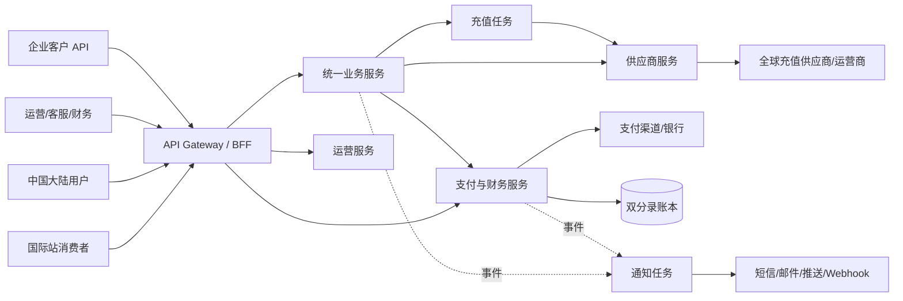

# 系统架构

状态：Draft

## 架构目标

WoLinkup 的首要目标不是“发出一次 API 请求”，而是在支付渠道和供应商都可能超时、重复、乱序的条件下，仍能保证不重复扣款、不重复充值、资金可追溯、状态可解释，并让运营人员安全处理例外。

## 系统上下文

## 部署策略

代码按服务责任分目录，但首期允许以下合并部署：

- `business-service` 与 `recharge-worker` 可共享发布流水线，运行进程分开。
- `operation-service` 可与 API gateway 同集群，但保持独立 schema。
- `payment-finance-service` 单独部署、单独权限和审计，禁止其他服务直写。
- 消息代理可从 PostgreSQL outbox + 轮询 worker 起步；吞吐量或隔离需求明确后再引入专用流平台。

## 核心请求链路

### 报价和下单

1. 客户端提交国家、号码、产品和展示币种。
2. 业务服务规范化号码，识别/验证运营商，读取已发布产品。
3. 定价模块锁定采购价、汇率、服务费、优惠和毛利规则，生成短期报价。
4. 客户端以 `Idempotency-Key` 用有效报价创建订单。
5. 订单保存价格快照和协议版本，状态为 `pending_payment`。

### 支付和充值

1. 支付服务创建支付意图并把渠道结果标准化。
2. 捕获成功后写入账本和 outbox；业务服务收到事件后将订单推进到 `paid`。
3. 路由先做资格过滤，再按策略评分，并保存候选和最终决策。
4. worker 建立充值尝试，通过供应商适配器提交；同步响应和异步回调走同一状态机。
5. 成功后确认收入/成本；明确失败进入退款；未知状态进入查询和人工复核。

## 一致性模型

- 服务内部：单数据库事务。
- 服务之间：事务 outbox、至少一次投递、幂等 inbox。
- 客户端重试：作用域化幂等键 + 请求哈希，参数不同时返回冲突。
- 回调：原始请求体验签后落库，以渠道事件 ID 去重。
- 查询：允许短暂最终一致，响应带更新时间和可解释状态。

## 数据存储

- PostgreSQL：交易事实、主数据、账本、审计和 outbox。
- Redis：限流、短期缓存、分布式租约；不保存唯一业务事实。
- 对象存储：对账文件、导入文件、发票和归档原始报文，使用受控访问与保留策略。
- 分析仓库：通过脱敏事件/CDC 构建，不直接对生产交易库跑重查询。

## 可用性取舍

报价和目录查询偏向可用，但使用带版本的短期缓存；支付、充值提交和账务偏向一致，依赖不可变事实和可恢复队列。供应商故障时宁可进入“处理中/人工复核”，也不在结果未知时冒险重复充值。
