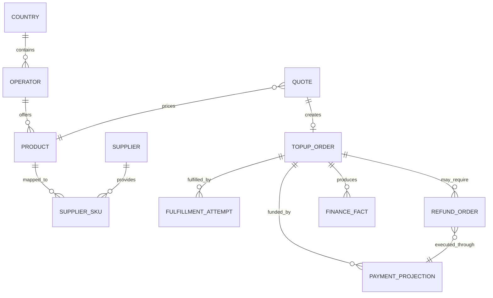

# 核心数据模型

状态：Draft

## 关系概览

## 建模重点

- `quote` 保存完整定价快照，不依赖下单后可能变化的费率。
- `topup_order` 保存加密号码、稳定哈希和脱敏值；常规列表不解密。
- `fulfillment_attempt` 每次只绑定一个 supplier SKU，attempt number 单调增加。
- `payment_projection` 只保存独立 Payment Platform 的引用、标准状态和事件证据，不复制支付渠道内部模型。
- `refund_order` 保存 TEL 的退款业务、审批与额度预占；支付侧执行结果通过平台投影回写。
- `finance_fact` 保存 TEL 可审计的业务资金事实，并与支付平台、供应商和退款对账。
- `order_status_history`、`audit_event` 和 outbox 不可变，采用分区/归档控制规模。

## 标识与时间

- 内部主键使用 UUID；顺序敏感场景可在实施时选 UUIDv7。
- 用户订单号与主键分离，格式不可编码敏感信息。
- 同时记录 `occurred_at`、`created_at`、`updated_at`；财务另有 `posted_at` 和财务日期。
- 数据库统一保存 UTC；国家/供应商的业务日用 IANA timezone 计算。

正式迁移顺序见 `database/migrations/README.md`。迁移文件未实现前，不把旧脚本或空 SQL 当作生产基线。
